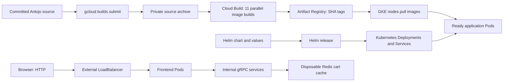

# Antojo: From a Git Commit to a Healthy GKE Release

> **Goal:** use the remaining trial window to learn real managed-cloud behavior,
> not spend the whole session installing local toolchains.
>
> This is a temporary, reviewable deployment bridge. It is **not** the final CI/CD
> architecture or a claim that the application is production-ready.

## Table of Contents

- [Learning contract](#learning-contract)
- [The delivery flow](#the-delivery-flow)
- [Helm and the chart](#helm-and-the-chart)
- [Values and image identity](#values-and-image-identity)
- [Cloud Build and Artifact Registry](#cloud-build-and-artifact-registry)
- [Bootstrap: predict, run, compare](#bootstrap-predict-run-compare)
- [Build and deploy: predict, run, compare](#build-and-deploy-predict-run-compare)
- [Inspect without changing anything](#inspect-without-changing-anything)
- [Optional traffic and Gateway exercises](#optional-traffic-and-gateway-exercises)
- [Validation and troubleshooting](#validation-and-troubleshooting)
- [Costs, safety, and the next architecture](#costs-safety-and-the-next-architecture)
- [References](#references)

## Learning Contract

For every step: explain **what**, explain **why**, predict the result, run it,
then compare the actual output with the prediction. Pause when the output differs.
Do not treat a successful command as proof that the whole system works.

The existing `antojo` Autopilot cluster in `antojo-lab`, `us-central1`, is reused.
Neither script creates, imports, destroys, or replaces a cluster. Terraform
adoption remains separate work.

No shopping assistant, Gemini API, Vertex AI call, or Gemini fallback is included.
These scripts also do **not** disable a separately running Gemini client or change
its existing billing configuration. Inspect those separately before using it.

Use only fake customers, fake addresses, and fake payment data. The payment service
is a simulator, not a real payment processor. Email is a simulated confirmation.
The public endpoint in this bridge is HTTP, without TLS or authentication.

## The Delivery Flow



The source archive is stored briefly in a private Cloud Storage bucket. Cloud
Build reads that archive and builds Linux/amd64 images remotely, even if the
submitter's Mac is ARM. Kubernetes schedules application Pods on amd64 nodes.

Build and deployment are separate trust boundaries. The dedicated build identity
can publish images and write logs, but has no Kubernetes deployment permission.
The signed-in human runs Helm using their existing GKE access.

## Helm and the Chart

Helm is a Kubernetes package manager and template renderer. A **chart** is the
package; a **release** is one installed instance of it, with its values and history.
Helm renders YAML and sends it to Kubernetes. The Kubernetes controllers, not Helm,
continuously reconcile Deployments into Pods.

Raw manifests make individual resources easy to read, but duplicating them for
environments invites drift. Kustomize overlays are also a valid production tool;
Helm is our deliberate choice for reusable packaging, configurable images, and
release history/rollback. We are not mixing both approaches in this project.

### Chart Structure

```text
charts/antojo/
├── Chart.yaml
├── values.yaml
├── values.schema.json
└── templates/
    ├── _helpers.tpl
    ├── deployments.yaml
    ├── services.yaml
    ├── redis.yaml
    ├── pdb.yaml
    ├── frontend-exposure.yaml
    └── NOTES.txt
```

| File | Responsibility |
| --- | --- |
| `Chart.yaml` | Package metadata and Kubernetes compatibility. |
| `values.yaml` | Reviewable defaults and service connections. |
| `values.schema.json` | Catch invalid values, including `latest` tags. |
| `_helpers.tpl` | Reuse labels, image names, and probe definitions. |
| `deployments.yaml` | Desired replicas, images, resources, and probes. |
| `services.yaml` | Stable internal DNS and ports. |
| `redis.yaml` | Disposable cache and its internal Service. |
| `pdb.yaml` | Voluntary disruption limits for three critical services. |
| `frontend-exposure.yaml` | Optional LoadBalancer or Gateway resources. |

The topology, gRPC addresses, ports, and health checks are adapted from the
upstream chart identified in `NOTICE`. Unused mesh, database, and assistant
options are intentionally not carried into this bridge.

### Template Vocabulary

`{{ .Values.global.imageTag }}` reads a value. `range` iterates over services;
`if` enables a resource conditionally. `include` calls a helper, and `nindent`
keeps the rendered YAML indentation valid.

`helm lint` checks the package. `helm template` renders without contacting GKE.
`helm upgrade --install` changes the cluster and stores a release revision.
`helm history antojo -n antojo` shows those revisions.

### Health and Availability

Readiness controls whether a Pod receives Service traffic. Liveness restarts a
container that fails its own health check. Startup probes give slower processes
up to five minutes before normal health checks begin.

Frontend uses `/_healthz`; backend services use native gRPC health probes. Redis
uses `redis-cli ping`. Headless Locust has no HTTP server: its probes check that
its local Locust process exists. That is a weak process-health signal, **not**
proof that simulated requests succeed; inspect the Locust logs for failures.

Frontend, checkout, and cart have two replicas and a `minAvailable: 1` PDB each.
This permits one healthy replica to be voluntarily evicted, not both together.
A PDB does not prevent a crash, involuntary node loss, or a zone outage. Soft
anti-affinity prefers separate hosts but does not guarantee zone resilience.

Every container is non-root, drops capabilities, blocks privilege escalation,
and uses `RuntimeDefault` seccomp. Root filesystems are read-only, with a small
writable `/tmp` where necessary. Pods do not mount Kubernetes API tokens.
These controls are not a substitute for network isolation or vulnerability scans.

## Values and Image Identity

All eleven application images share this registry prefix:

```text
us-central1-docker.pkg.dev/antojo-lab/antojo
```

The default `global.imageTag: build-required` exists only so local rendering and
linting work before a first build. No such image is published. The deployment
script always replaces it with the current Git commit's short SHA.

A service's `image.tag` is empty by default, meaning **inherit the global tag**:

```bash
helm template antojo charts/antojo -n antojo \
  --set-string global.imageTag=abcdef1 \
  --set-string services.frontend.image.tag=1234567
```

**Predict:** which image differs from the other ten? **Expected:** only frontend
uses `1234567`. This is useful for controlled experiments, but manual overrides
can create incompatible service versions. The deploy script intentionally uses
one tag for the whole application.

A SHA tag links an image to reviewed source more clearly than `latest`. A tag is
still a mutable registry pointer: rebuilding the same commit can produce a new
digest if dependencies change. This bridge pins the Go runtime and Redis image;
future CI will scan images and deploy by recorded digest. It is not fully
reproducible or provenance-verified yet.

### Autopilot Resource Choices

Each application Pod requests `250m` CPU, `512Mi` memory, and `100Mi` ephemeral
storage. Those requests fit General-purpose Autopilot minimums even without
bursting, and the allowed CPU-to-memory ratio. Limits permit controlled bursts;
Autopilot can adjust requests/limits depending on the cluster's capabilities.

The default release has 13 application replicas plus Redis: **3.5 vCPU and 7 GiB
of requested memory**, before system resources and temporary rollout surge.
Enabling Locust adds one Pod. These are conservative lab defaults, not measured
production right-sizing. Observe actual admitted resources and usage first.

Redis uses `emptyDir` and has no persistence or HA. Replacing it loses carts.
Its Recreate strategy avoids splitting clients across two independent stores.
It is a deliberate, temporary lab trade-off, not a production database design.

## Cloud Build and Artifact Registry

**Cloud Build** supplies a managed builder VM, executes the configured steps, and
records logs, including pushed image digests. The eleven Docker builds depend only on the
validation step, so they can run in parallel on `E2_HIGHCPU_8`. Each step builds and pushes its own image. A partial failure can leave
some published images, but a failed overall build does not proceed to Helm.

**Artifact Registry** stores images; it does not build them or run containers.
Each service has its own image package in the regional `antojo` Docker repository.

Cart's build context is `services/cartservice/src`, where its Dockerfile expects
`cartservice.csproj`. Every other context is `services/<service>`. The first build
step checks every Dockerfile path and rejects a missing/non-SHA `_TAG`.

Triggered builds inherit `$SHORT_SHA`. Manual submissions have no automatic
source SHA; supply `_TAG` explicitly. The script does that for you.

The builder has eight vCPUs but limited memory shared by all builds. Eleven-way
parallelism may cause an out-of-memory build under heavy compiler load. This has
not been measured with a real Cloud Build run yet. If it occurs, inspect the
failing step before deliberately adjusting concurrency or machine size.

## Bootstrap: Predict, Run, Compare

### Before the First Run

Review the stacked PR branch without merging it. In your Mac's existing checkout:

```bash
cd ~/antojo
git status --short
git fetch origin
git switch feat/helm-cloudbuild
code docs/learning/helm-cloudbuild.md
```

Expect `git status --short` to be empty. If it is not, keep your changes and stop;
do not reset or overwrite them. After opening the guide, press `Cmd+Shift+V` for
VS Code Markdown Preview. Mermaid rendering may require a preview extension.

You need Git, current gcloud, Helm 3, kubectl, and `gke-gcloud-auth-plugin` installed.
Use the already authorized gcloud account; neither script asks for a JSON key.

The bootstrap operator must be allowed to enable APIs, create the repository,
build service account and source bucket, update project IAM for log writing,
and read the existing cluster. Build submission also requires
`iam.serviceAccounts.actAs` on `antojo-cloud-build` and permission to create builds
and upload sources. Do not grant Editor to make an error disappear.

```bash
bash scripts/bootstrap-lab.sh
```

This changes the cloud project but does not deploy workloads. It can be rerun:
existence checks skip creation; IAM additions and policies converge on the same
configuration. Permission failures stop the script rather than being mistaken
for absent resources.

### Step 1: Enable APIs

**What/why:** enable Artifact Registry, Cloud Build, IAM, Storage, and Logging so
the following calls are available. Enabling an API alone does not run a workload.

**Predict:** will a second run create a second service? **Expected:** no; already
enabled APIs stay enabled. No Gemini API is enabled by this script.

### Step 2: Create the Registry if Absent

**What/why:** store images in `us-central1`, near the existing cluster.

**Predict:** what changes on a second run? **Expected:** the existing repository
is found; no duplicate is created. A permission denial is an error, not a retry.

### Step 3: Limit Image Retention

**What/why:** retain the five most recent versions **per image package**, and
delete older extras after a one-day grace period. A keep-only policy deletes
nothing, so there is also a delete rule. Keep takes precedence.

**Predict:** will version six disappear immediately? **Expected:** no. Background
cleanup is periodic, and recently uploaded versions have the grace period.
Cleanup does not check which digest Kubernetes is currently running. An old
active image can eventually disappear after enough builds; a new Pod would then
fail to pull it. Keep active releases protected before adopting this in production.

### Step 4: Separate Build and Node Identities

**What/why:** create `antojo-cloud-build`, grant it repository-scoped Writer and
project Log Writer. `cloudbuild.yaml` explicitly names it. Default Cloud Build
identities vary by project; we do not assume the legacy default SA is in use.

**Predict:** can this account deploy to GKE? **Expected:** not with the permissions
we grant. It can publish images, not administer the cluster. It is not the GKE
node identity, so nodes do not gain write access through a shared default SA.

### Step 5: Stage Sources Privately

**What/why:** a private, uniform-access bucket stores the source archive. The build
SA receives Object Viewer on this bucket only. A one-day object lifecycle limits
archive retention, with soft delete disabled on this disposable bucket so it does
not retain another seven days of recoverable archives. `.gcloudignore` allowlists build inputs and excludes common
credentials and generated files; never put secrets in service source files.

**Predict:** does the build SA need project-wide Storage Admin? **Expected:** no.
The signed-in submitter uploads the archive; the builder only reads it.

### Step 6: Let Nodes Pull, Not Push

**What/why:** discover node-pool Google service accounts, resolving `default` to
the project's Compute Engine default SA, then grant repository-scoped Reader.

**Predict:** does the Pod's Kubernetes SA pull the image? **Expected:** no. The
node's Google identity does that before the application starts. Workload Identity
for application API access is a different concern.

IAM changes can take a little time to propagate. If the first build is denied
immediately after bootstrap, inspect the named principal and role before rerunning.

## Build and Deploy: Predict, Run, Compare

```bash
bash scripts/build-and-deploy.sh
```

### Step 1: Check Source and Render

**What/why:** refuse dirty build/deployment inputs, derive the SHA, then lint and
render locally. Unrelated notes are not sent as build context.

**Predict:** what happens with an edited Dockerfile? **Expected:** stop before any
Cloud Build spend. Commit the intended change, or stash it without losing it.

### Step 2: Select the Existing Cluster

**What/why:** refresh credentials for `antojo`, then verify connectivity. All
kubectl and Helm calls explicitly target `gke_antojo-lab_us-central1_antojo`.

**Predict:** could your current kind context receive this release? **Expected:**
no; the explicit context prevents that. A missing auth plugin fails here, before
building images. No cluster is created.

### Step 3: Submit the Remote Build

**What/why:** upload only allowed source files; build and push eleven SHA-tagged
images on Cloud Build. The command uses `_TAG=$(git rev-parse --short HEAD)`.

**Predict:** if one Dockerfile fails, does Helm run? **Expected:** no. `set -e`
stops on the nonzero build exit code. Inspect the failing remote build step.

### Step 4: Install and Wait

**What/why:** `helm upgrade --install` creates the namespace/release or upgrades
it, waiting up to twenty minutes for readiness and LoadBalancer allocation.
Then explicit rollout checks inspect each release Deployment.

**Predict:** does API acceptance mean success? **Expected:** no. Probes must pass.
`--atomic` rolls back a failed upgrade; a failed first install is removed. That
can erase first-install Pods before diagnosis, so keep the Helm output and use
Cloud Build logs/events. It does not promise application-level correctness or
undo an external cloud bootstrap.

### Step 5: Inspect the Address

**What/why:** print the actual `frontend-external` address, not a guessed URL.

**Predict:** does an allocated IP prove checkout works? **Expected:** no. Browse
the menu, add a cart item, and submit a fake order as an end-to-end smoke test.
Capture latency and failure observations for the next SRE exercise.

## Inspect Without Changing Anything

```bash
kubectl --context=gke_antojo-lab_us-central1_antojo get pods,svc,pdb -n antojo
helm --kube-context=gke_antojo-lab_us-central1_antojo history antojo -n antojo
kubectl --context=gke_antojo-lab_us-central1_antojo top pods -n antojo
kubectl --context=gke_antojo-lab_us-central1_antojo logs -n antojo deployment/checkoutservice --tail=50
```

`top` needs the metrics API and samples may not exist immediately. Compare actual
resource requests in `kubectl describe pod` with the values before interpreting
billed capacity. Never infer remaining trial credits from Pod requests alone.

## Optional Traffic and Gateway Exercises

These are separate, deliberate exercises after the first deployment succeeds.
Each Helm upgrade below can allocate or retain billable resources.

### Turn On Synthetic Traffic

```bash
helm upgrade antojo charts/antojo -n antojo \
  --kube-context=gke_antojo-lab_us-central1_antojo --reuse-values \
  --set services.loadgenerator.enabled=true --wait --timeout=20m
```

Predict the additional Pod and its logs before running. To stop traffic, repeat
with `services.loadgenerator.enabled=false`. This does not delete the app or LB.

### Try Gateway Instead of the Service LoadBalancer

First verify the GKE Gateway controller is enabled and the selected GatewayClass
exists. Do not change networking during a healthy first deployment just to enable
this toggle. The optional chart resources are Gateway API `v1`, not Istio.

```bash
kubectl --context=gke_antojo-lab_us-central1_antojo get gatewayclass
```

After prerequisites are verified, the chart supports this mutually exclusive swap:

```bash
helm upgrade antojo charts/antojo -n antojo \
  --kube-context=gke_antojo-lab_us-central1_antojo --reuse-values \
  --set frontend.externalService=false \
  --set frontend.gateway.enabled=true --wait --timeout=20m
kubectl --context=gke_antojo-lab_us-central1_antojo get gateway,httproute -n antojo
```

Expect a new public address and a provisioning transition. Read Gateway/HTTPRoute
status conditions and verify a browser request: Helm does not wait for Gateway
programming. HTTP only is provided here; certificate provisioning and TLS are a
later cloud lesson. The build/deploy script uses the default Service LoadBalancer
path and is not the command for the optional Gateway mode.

For no external exposure, set both toggles false and use `kubectl port-forward`
against `svc/frontend`. The internal frontend Service always remains ClusterIP.

## Validation and Troubleshooting

Local validation does not require a cloud account:

```bash
helm lint charts/antojo
helm template antojo charts/antojo -n antojo > /tmp/antojo.yaml
kubeconform -strict -summary /tmp/antojo.yaml
bash -n scripts/bootstrap-lab.sh scripts/build-and-deploy.sh
shellcheck scripts/bootstrap-lab.sh scripts/build-and-deploy.sh
python3 -m unittest discover -s tests -p 'test_lab_scripts.py' -v
```

The Python tests mock the CLIs and validate idempotency, IAM scope, dirty-input
protection, explicit contexts, rollout checks, and failure behavior. They do not
validate live Google IAM permissions or run Docker builds.

| Symptom | First thing to inspect |
| --- | --- |
| Build rejected | `_TAG`, build SA `actAs`, enabled APIs. |
| Source download denied | Object Viewer on the source bucket. |
| Push denied | Writer on the regional repository. |
| `ImagePullBackOff` | Image path/tag and node SA Reader role. |
| `CrashLoopBackOff` | Container logs, memory, writable paths. |
| Pods `Pending` | Events, quota, admitted Autopilot requests. |
| IP still pending | Service events and regional networking quotas. |
| Unhealthy Gateway | Controller, status conditions, backend health. |

All Dockerfile paths are checked statically. Go runtime/support image manifests
were checked for availability, but local lint/schema tests are not proof that
eleven container builds or an end-to-end deployment pass. Do not claim otherwise
until the real Cloud Build run and browser smoke test succeed.

## Costs, Safety, and the Next Architecture

Build minutes, image/source storage, GKE requests, external load balancing, and
logs can all cost money. Promotional-credit eligibility must be confirmed in
Billing for each service. Budget alerts are not a hard spending cap. Do not spend
credits just to empty a balance; spend them on a measured learning objective.

Do not run Gemini as part of this exercise. This application has no AI path yet;
Chava and Guardia remain future work, with no Gemini fallback provisioned here.

Record evidence and plan teardown **by November 17, 2026 (America/Mexico_City)**,
before the reported November 18 trial expiry. Stopping traffic does not stop GKE,
LB, or storage charges. Helm uninstall also does not remove the bootstrap
repository, source bucket, SA, IAM bindings, or cluster. No destruction command
is automated in these scripts; review the full inventory before deleting it.

This temporary bridge later becomes:

1. GitHub Actions with Workload Identity Federation, without JSON keys.
2. Trivy scanning, pinned Actions, and recorded image digests/provenance.
3. Terraform adoption of existing infrastructure, without cluster replacement.
4. Argo CD reconciling the Helm release from Git rather than a laptop.
5. NetworkPolicies, managed secrets, observability, SLOs, alerting, and runbooks.

Cloud Build is already a professional managed builder. What makes this a bridge
is the manual submission and Helm deployment, not the quality of the service.
The learning objective now is the managed-cloud feedback loop; rebuild the
supporting pieces by hand later to explain each boundary confidently.

## References

- [Helm charts](https://helm.sh/docs/topics/charts/)
- [Cloud Build configuration](https://docs.cloud.google.com/build/docs/build-config-file-schema)
- [Cloud Build substitutions](https://docs.cloud.google.com/build/docs/configuring-builds/substitute-variable-values)
- [User-specified build identities](https://docs.cloud.google.com/build/docs/securing-builds/configure-user-specified-service-accounts)
- [Artifact Registry cleanup policies](https://docs.cloud.google.com/artifact-registry/docs/repositories/cleanup-policy)
- [Autopilot resource requests](https://docs.cloud.google.com/kubernetes-engine/docs/concepts/autopilot-resource-requests)
- [GKE Gateway deployment](https://docs.cloud.google.com/kubernetes-engine/docs/how-to/deploying-gateways)
