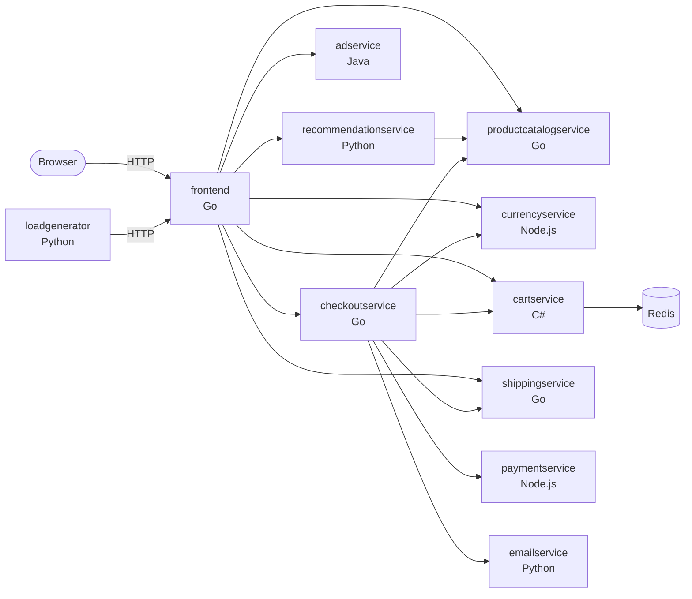
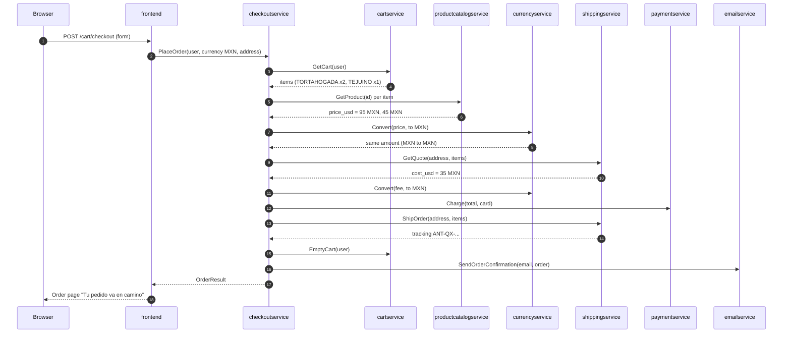

# Learning guide: the Antojo app PR

A reviewer's guide to branch `feat/antojo-app`. It explains what each service
does, what changed and why, and how to check it yourself before you trust it.

> **Tip:** Open with `Cmd+Shift+V` (or `Ctrl+Shift+V`) in VS Code to see the
> rendered Markdown and the diagrams.

## Table of contents

- [How to use this guide](#how-to-use-this-guide)
- [The system in one picture](#the-system-in-one-picture)
- [A checkout request, step by step](#a-checkout-request-step-by-step)
- [Why the gRPC contracts did not change](#why-the-grpc-contracts-did-not-change)
- [Service by service](#service-by-service)
  - [frontend](#frontend)
  - [productcatalogservice](#productcatalogservice)
  - [currencyservice](#currencyservice)
  - [shippingservice](#shippingservice)
  - [checkoutservice](#checkoutservice)
  - [emailservice](#emailservice)
  - [adservice](#adservice)
  - [loadgenerator](#loadgenerator)
  - [cartservice](#cartservice)
  - [Unchanged services](#unchanged-services)
- [Predict before you run](#predict-before-you-run)
- [Review checklist](#review-checklist)
- [Glossary](#glossary)

## How to use this guide

Read the diagram first, then one service section at a time with the matching
commit open next to it:

```bash
git log --oneline main..feat/antojo-app
git show <commit-sha> --stat
```

Each section ends with what to look at in review. The exercises at the end ask
you to write down a prediction **before** running a command. Being wrong is
the useful part: it shows where your mental model needs work.

## The system in one picture

Antojo is eleven small services. The browser talks HTTP only to `frontend`.
Every other call is synchronous gRPC, defined in `protos/demo.proto`.



## A checkout request, step by step

When you press **Hacer pedido**, one HTTP POST fans out into many gRPC calls.
This is where the menu, the MXN price, and the delivery fee meet.



Key idea: every `Money` value carries its own `currency_code`. The services
convert whatever they get, so switching the menu and the delivery fee to MXN
needed no change in `checkoutservice` logic.

## Why the gRPC contracts did not change

`protos/demo.proto` is the shared contract. Changing it means regenerating
code in five languages and redeploying everything together. This PR avoids
that on purpose:

| Field | Name says | Now holds |
|---|---|---|
| `Product.price_usd` | USD | MXN price |
| `GetQuoteResponse.cost_usd` | USD | MXN fee |
| `package hipstershop` | upstream name | unchanged |

The names are now misleading, but they are wire-compatible. Renaming them is a
later, separate PR (Phase 3 in the redesign plan) together with new RPCs.

> **Tip (interviews):** "Keep the wire format, change the meaning, document
> it" is a classic backwards-compatible migration step. Be ready to explain
> the trade-off.

## Service by service

### frontend

**Role.** Go HTTP server. Renders HTML templates and calls the backends.

**Files changed.**

| File | Why |
|---|---|
| `main.go` | `defaultCurrency = "MXN"`, MXN whitelisted, assistant routes removed |
| `handlers.go` | `"MXN": "$"` symbol, assistant and bot handlers removed |
| `templates/*.html` | Antojo name, Spanish-MX copy, `lang="es-MX"` |
| `static/` | Self-made logo, favicon, hero, dish images, new colors |

**Flow.** The currency cookie defaults to MXN. `frontend` asks
`currencyservice` to convert each price into the user currency before
rendering, so MXN prices pass through unchanged.

**Review.** Check that removing the assistant left no dangling template
references (`grep -rn assistant services/frontend`). Check that
`SHOPPING_ASSISTANT_SERVICE_ADDR` is no longer required at startup.

### productcatalogservice

**Role.** Serves the menu from `products.json` over gRPC.

**Files changed.** Only `products.json`: 11 dishes, `currencyCode: "MXN"`,
categories `tortas`, `caldos`, `tacos`, `bebidas`, `postres`.

**Flow.** Categories travel to `frontend`, which sends them to `adservice` as
context keys. That is why the promo categories must match these names.

**Review.** Every `picture` path must exist under
`services/frontend/static/img/products/`. Every category should have a promo.

### currencyservice

**Role.** Converts money between currencies using a EUR-based table.

**Files changed.** None. `data/currency_conversion.json` already has
`"MXN": "21.7999"`.

**Review.** Read `server.js` `convert()`: it divides by the source rate, then
multiplies by the target rate. Any code in the table works.

### shippingservice

**Role.** Quotes the delivery fee and issues tracking IDs.

**Files changed.**

| File | Why |
|---|---|
| `quote.go` | Flat 35 MXN fee, free from 6 items, 25-45 min ETA |
| `main.go` | Returns `MXN`, logs fee and ETA |
| `tracker.go` | `ANT-` tracking prefix |
| `shippingservice_test.go` | Tests for MXN fee, threshold, ETA, ID format |

**Why items, not pesos, for "free delivery".** `GetQuoteRequest` contains
product IDs and quantities, not prices. A peso threshold would need a proto
change or a catalog lookup, so an item-count threshold keeps this PR small.

**Review.** Look at `CreateQuoteFromFloat`: it now rounds cents with
`math.Round`, which avoids 34.99 style float errors.

### checkoutservice

**Role.** Orchestrates an order (see the sequence diagram).

**Files changed.** `main.go`: `status.Errorf(codes.Internal, err.Error())`
became `status.Error(...)`. Using a dynamic string as a format string is a
real bug (a `%` in the message would be misread) and newer `go vet` rejects it.

### emailservice

**Role.** Renders and (in real mode) sends the order confirmation.

**Files changed.** `templates/confirmation.html` (Spanish copy, delivery
fee, ETA) and the subject line in `email_server.py`. The template also fixes
upstream address fields to match the `Address` proto.

**Review.** In dummy mode the service only logs, so the template is not
exercised in a normal run. See exercise 4 to render it yourself.

### adservice

**Role.** Java gRPC service that returns text ads for a category.

**Files changed.** `AdService.java` `createAdsMap()`: restaurant promos keyed
by the menu categories, each linking to a dish.

**Review.** Check that each `setRedirectUrl` points at a real product ID.

### loadgenerator

**Role.** Locust script that simulates customers against `frontend`.

**Files changed.** `locustfile.py`: new dish IDs, `es_MX` fake data with
Guadalajara addresses, and `lunch_order` / `dinner_order` tasks.

### cartservice

**Role.** C# service that stores carts in Redis, Spanner or AlloyDB.

**Files changed.** Default Spanner instance name is now `antojo`.

### Unchanged services

`paymentservice` and `recommendationservice` work as-is. Their code only
moved from `src/` to `services/`.

## Predict before you run

Write your answer down first, then run the command.

**1. Delivery fee for 5 versus 6 items.** What does `CreateQuoteFromCount`
return for 5 and for 6?

```bash
cd services/shippingservice
go test -run 'TestFreeDeliveryThreshold|TestGetQuote' -v ./...
```

**2. Tracking ID length.** `ShipOrder` builds an ID from an address. How long
is it for the test address, and why does the test expect 22?

```bash
go test -run TestShipOrder -v ./...
```

**3. A broken catalog.** If you change one `currencyCode` to `"XYZ"`, will
the catalog tests catch it? If not, which service would fail at runtime, and
why? (Hint: look at `convert()` in `currencyservice`.) Revert the change after.

```bash
cd services/productcatalogservice
go test ./...
```

**4. The confirmation email.** Predict the line that shows the delivery fee,
then render the template with sample data:

```bash
cd services/emailservice
python3 -m venv .venv && .venv/bin/pip install jinja2
.venv/bin/python - <<'PY'
from types import SimpleNamespace as N
from jinja2 import Environment, FileSystemLoader
m = lambda u: N(units=u, nanos=0, currency_code="MXN")
order = N(order_id="demo", shipping_tracking_id="ANT-QX-1-2",
          shipping_cost=m(35),
          shipping_address=N(street_address="Av. Chapultepec 123",
                             city="Guadalajara", state="Jalisco",
                             country="Mexico", zip_code=44160),
          items=[N(item=N(product_id="TORTAHOGADA", quantity=2), cost=m(95))])
env = Environment(loader=FileSystemLoader("templates"))
print(env.get_template("confirmation.html").render(order=order))
PY
```

**5. Currency math.** Using the rate table, how many USD is a 95 MXN torta
(`USD = 1.1305`, `MXN = 21.7999` per EUR)? Check by hand:
95 / 21.7999 * 1.1305.

**6. Whole stack.** Run the app locally (see `PR_BODY.md`, "How to verify"),
switch the currency to USD, and predict the cart total before you look.

## Review checklist

- [ ] `NOTICE` names upstream and commit `c7cb6d5`
- [ ] Modified upstream files keep their Apache header plus the Antojo notice
- [ ] No Google logos or trademarks in the UI or images
- [ ] Every Go service: `go build`, `go test` pass
- [ ] Product IDs match across catalog, ads, loadgenerator, tests
- [ ] No proto changes
- [ ] No Helm, Terraform or CI in this PR

## Glossary

| Term | Meaning |
|---|---|
| gRPC | RPC framework using HTTP/2 and Protocol Buffers |
| proto | `.proto` file that defines messages and services |
| genproto | Code generated from the proto, per language |
| Locust | Python load-testing tool |
| Birote | Crusty Guadalajara bread used for tortas ahogadas |
